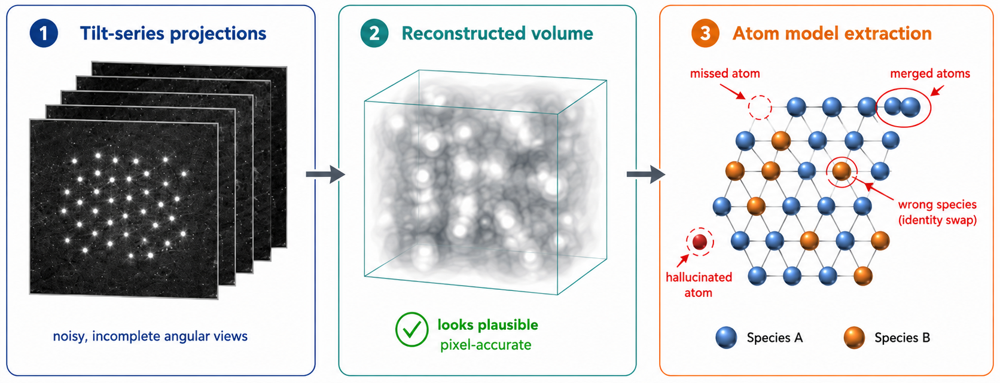
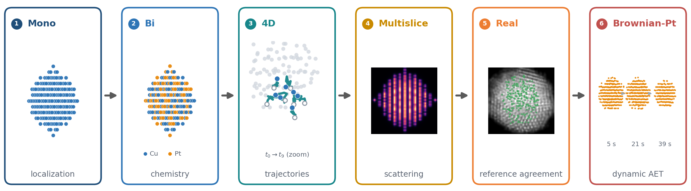

# AET-Bench: Pixel-Accurate Atomic Tomography Is Not Atom-Accurate

**NeurIPS 2026, Evaluations and Datasets Track**

Zicheng Liu<sup>1</sup>, Wenzhuo Ma<sup>2</sup>, Jintao Chen<sup>5</sup>, Di Huang<sup>1,2,3,4,\*</sup>

<sup>1</sup>BCC Lab, Hangzhou International Innovation Institute, Beihang University, Hangzhou, China<br>
<sup>2</sup>Zhejiang Industrial Big Data and Robot Intelligent System Key Laboratory, Hangzhou Innovation Institute, Beihang University, Hangzhou, China<br>
<sup>3</sup>State Key Laboratory of Complex and Critical Software Environment, Beihang University, Beijing, China<br>
<sup>4</sup>Shenzhen Loop Area Institute, Shenzhen, China<br>
<sup>5</sup>Zhejiang University, Hangzhou, China<br>
<sup>\*</sup>Corresponding author: Di Huang (dhuang@buaa.edu.cn)

[Paper (OpenReview)](https://openreview.net/forum?id=GmdQ25dIWq) ·
[Dataset (Hugging Face)](https://huggingface.co/datasets/pone7/4D-ATE) ·
[Code (this repository)](https://github.com/pone7/4D-ATE)

---

Atomic electron tomography (AET) aims to recover the 3D positions, chemical
species, and temporal trajectories of individual atoms, yet reconstructions
are usually scored with voxel metrics such as PSNR, SSIM, and FSC. AET-Bench
evaluates reconstructions by the atoms, species, and trajectories scientists
actually use, and shows that the two views can rank methods in opposite
order.



**Figure 1: pixel-accurate is not atom-accurate.** A reconstruction can be
pixel-accurate while the atom model extracted from it is wrong: atoms can be
missed, merged, hallucinated, or given the wrong species.

## The benchmark

* **755 samples on a six-tier realism ladder**: Mono (analytical), Bi (binary
  alloys), 4D (atomic dynamics), Multislice (scattering-aware, pilot), Real
  (experimental tilt series, scored as agreement with reference atom models),
  and Brownian-Pt (dynamic Pt nanocrystals).
* **Four tasks**: volume reconstruction, atom localization, species
  identification, and 4D trajectory recovery.
* **Atom-first metrics**: Hungarian-matched atom recall, precision, and
  localization RMSD; species accuracy; trajectory RMSD and identity
  persistence. Voxel metrics are kept as diagnostics.
* **21 logged method entries** (14 implementations across classical,
  regularized, implicit-neural, and Gaussian / 4D families) run through one
  harness with a shared, unit-tested volume-to-atom extractor.



**Figure 2: the realism ladder.** Each tier adds one source of difficulty:
localization, chemistry, trajectories, scattering physics, experimental
reference agreement, and dynamic tracking.

### Headline result (Mono tier, n = 50)

| Method | SSIM ↑ | Atom recall ↑ | RMSD (Å) ↓ |
|---|---|---|---|
| MLEM | **0.946** | 0.809 | 0.390 |
| 4D-GS | 0.896 | 0.439 | 0.500 |
| X²-Gaussian | 0.852 | 0.188 | 0.534 |
| SIRT | 0.798 | 0.884 | 0.358 |
| FISTA-TV | 0.506 | **0.969** | **0.219** |

The method with the best voxel similarity is not the one that recovers the
most atoms. The ordering holds across matching radii, under a
representation-native extractor for Gaussian methods, and against a
ground-truth extraction ceiling (paper, Section 6.2).

## Repository layout

```
scripts/          evaluation harness, method wrappers, metrics, analyses
  run_benchmark.py            unified entry point (METHOD_REGISTRY)
  evaluate_baselines.py       shared volume -> atom extraction + Hungarian matching
  metrics/                    FSC, trajectory / identity-persistence metrics
  baselines/                  reconstruction method wrappers
  analysis/                   extraction sensitivity, GT ceiling, native extraction, tau sweep
  paper/                      reproduce the paper's tables, Figure 3, and the dataset SUMMARY.md
tests/            unit tests, incl. the extraction-ceiling regression guard
configs/          method configuration files
figures/          paper Figures 1 and 2 (PNG + PDF)
croissant.json    Croissant 1.0 metadata for the Hugging Face dataset
```

## Installation

```bash
conda env create -f environment.yml
conda activate aet-bench
pytest -q tests/
```

## Data

The dataset is hosted on Hugging Face:
<https://huggingface.co/datasets/pone7/4D-ATE>. Each tier is a tar archive
(large tiers are split into `.part-NNN` files; concatenate them before
extracting), and `SHA256SUMS` on the dataset page lists the checksums. The
benchmark result log `results.jsonl` is published alongside the data.

Scripts expect the data under the prefix `/data/aet-bench`. To use another
location, rewrite the prefix:

```bash
grep -rl '/data/aet-bench' scripts tests | xargs sed -i "s|/data/aet-bench|$PWD|g"
```

## Running the benchmark

```bash
python scripts/run_benchmark.py --subset mono --sample Cu-0165-00 --method wbp --task T1
```

See `CONTRIBUTING.md` for adding a new reconstruction method or data tier.

## Reproducing the paper's numbers

All leaderboard numbers in the paper (Table 4, the appendix leaderboards with
95% bootstrap confidence intervals, and Figure 3) are computed from the
released `results.jsonl`:

```bash
python scripts/paper/aggregate_results.py --results results.jsonl --out paper_results.json
python scripts/paper/make_latex_tables.py --agg paper_results.json --outdir tables/
python scripts/paper/fig_findings.py --agg paper_results.json --out findings.pdf
```

Aggregation rules: Mono and Bi use their canonical base samples (50 and 30;
sample ids with an `-sNN` augmentation suffix are excluded); every metric is
averaged over samples with one result per sample (the most recently logged
run); atom metrics are taken only from rows whose atom evaluation passed the
v2 audit; confidence intervals are percentile bootstrap, 1,000 resamples.
`tests/test_paper_aggregation.py` covers these rules.

## Citation

```bibtex
@inproceedings{liu2026aetbench,
  title     = {{AET-Bench}: Pixel-Accurate Atomic Tomography Is Not Atom-Accurate},
  author    = {Liu, Zicheng and Ma, Wenzhuo and Chen, Jintao and Huang, Di},
  booktitle = {Advances in Neural Information Processing Systems (NeurIPS), Evaluations and Datasets Track},
  year      = {2026}
}
```

## License

Code in this repository is released under the [MIT License](LICENSE). The
AET-Bench dataset is released under
[CC BY 4.0](https://creativecommons.org/licenses/by/4.0/).

## Acknowledgments

This research was supported by the Ningbo Science and Technology Project
(Grant No. 2025Z058), the Postdoctoral Innovative Talent Support Program of the
China Postdoctoral Science Foundation (Grant No. BX2026462), the China
Postdoctoral Science Foundation General Program (Grant No. 2026M794682), the
Priority-Funded Postdoctoral Research Project of Zhejiang Province (Grant No.
ZJ2026116), the Research Program of State Key Laboratory of Complex and
Critical Software Environment, and the Fundamental Research Funds for the
Central Universities.
